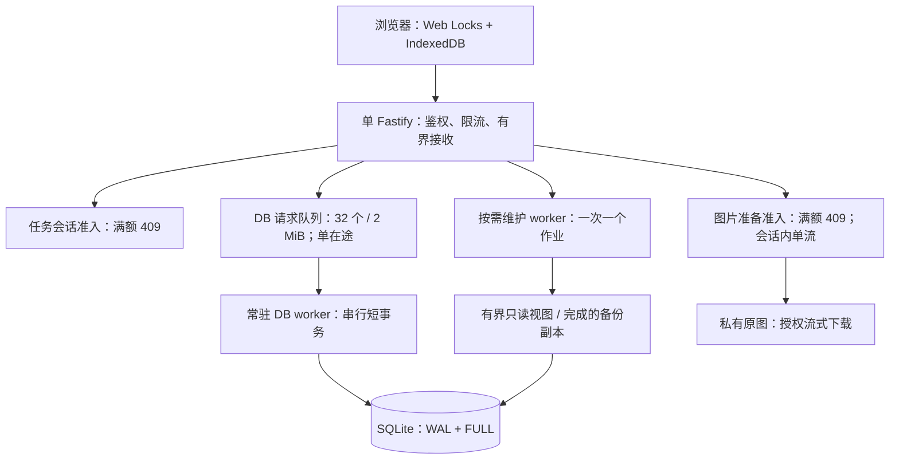

# 并发设计与容量验收

更新日期：2026-10-11（Asia/Shanghai）。本文按当前源码整理任务准入、图片准备、请求背压和单机容量，覆盖旧文档的 FIFO 等待、固定 1–2 例上限和计时组内零 HTTP 规则。业务状态与恢复合同见 [当前项目逻辑与设计优化](当前项目逻辑与设计优化.md)，部署操作见 [部署与恢复手册](部署与恢复手册.md)。

## 1. 单机执行结构

应用使用一个 Node.js/Fastify HTTP 主线程、一个常驻 SQLite 数据库 worker，以及至多一个按需维护 worker。HTTP 可以同时接收请求和流式发送文件；业务数据库操作通过唯一 worker 串行执行。维护 worker 使用独立只读连接或已完成的备份副本进行重放、导出和文件工作，状态发布仍通过数据库 worker。



两个业务准入器都不保存等待队列。数据库内部队列仍然存在，并按数量和字节限制；其中同类别的 FIFO 顺序不表示参加者可以排队等待名额。独立 worker 会竞争 CPU、内存和磁盘，容量测试需要包括维护负载。

实现入口：[HTTP 启动](../src/server/main.ts)、[DB 调度](../src/server/writer.ts)、[数据库 worker](../src/server/db-worker.ts)、[维护 worker](../src/server/maintenance.ts)。

## 2. 配置默认值与容量证据

| 项目 | 源码及部署示例默认 | 配置范围 | 作用 |
| --- | --- | --- | --- |
| `SESSION_CONCURRENCY` | 2 | 整数 1–10000 | 所有研究合计的任务会话名额 |
| `PREPARATION_CONCURRENCY` | 1 | 整数 1–10000 | 所有会话合计的图片准备名额 |
| 同一会话的图片传输 | 1 | 由实现固定 | 单个准备票据只允许一个在途图片流 |
| 重型维护作业 | 1 | 由实现固定 | 重放、导出、备份、重建、上传校验和维护删除 |

配置范围只表示服务接受哪些值。默认 2／1 是部署起点；[ECS 容量记录](ecs-capacity-and-idle.md)中的 7／7 是特定图片评分负载的运行上限，两者不能混作同一个默认值。仓库文档不代表在线服务当前加载的环境配置。

配置写入受保护的服务环境文件，重启后生效。调低任务上限时保留已有有效占位，超额期间拒绝新增任务。一个数据库只允许一个应用 owner，增加应用进程数不能扩大该数据库的准入容量。

## 3. 任务会话准入

冻结协议的 `groups` 非空时，整份答卷计入全局任务名额。占位从进入作答开始，覆盖任务前的问卷、图片准备、等待开始、任务执行及正常完成前的保存确认。`groups` 为空的纯问卷不占这类名额，仍受 HTTP、数据库、认证、存储和设备预算约束。

名额检查及状态变更在数据库 worker 的同一个短事务中执行，并发请求不能同时通过最后一个空位。满额返回 `SESSION_CAPACITY_FULL`、HTTP 409 和 `Retry-After: 1800`；界面建议约 30 分钟后重试，不显示等待序位，不轮询等名额，也不自动启动。此时间是重试建议，不是预约或届时有名额的承诺。

| 情况 | 现行行为 |
| --- | --- |
| 正常完成或明确终止 | 释放任务名额；后来的请求重新检查容量 |
| 活动会话续租 | 5 分钟租约；问卷及准备阶段每分钟续活，租约写入最多每分钟一次 |
| 无 `ISSUED` permit 且租约过期 | 在后续准入或状态查询的清理中标为 EXPIRED；保留答卷及原始记录 |
| 仍有 `ISSUED` permit | 普通准入租约过期不直接释放；防止未知任务与第二写者重叠 |
| 新策略任务失联 | 按第 5 节终止会话、关闭未知 permit，并释放名额 |
| 历史 `QUEUED` 条目 | 清理为 LEFT，保留原始答案；参加者需要显式重试 |

`lab_session_queue`、ticket、ordinal、`QUEUED` 类型等旧命名为兼容而保留。当前 `stats().queued` 固定为 0；`active` 包含纯问卷，应使用 `limited_active` 判断任务占用，`unlimited_active` 表示纯问卷，`pinned` 表示未关闭许可占位。

实现入口：[SessionAdmission](../src/server/session-admission.ts)、[业务门控](../src/server/lab-store.ts)、[浏览器准入](../src/web/session-gate.ts)。

## 4. 图片准备准入

准备名额与任务名额分别检查。会话已取得任务名额仍可能遇到图片准备满额，此时返回 `PREPARATION_CAPACITY_FULL`、HTTP 409 和 `Retry-After: 1800`。`PreparationQueue` 目前只管理活动票据，`queued` 固定为 0。

票据绑定会话、writer epoch、组位置与预留方案。同一准备票据至多一个图片流；浏览器逐张下载原字节、核对 SHA-256、检查尺寸并实际解码，按摘要复用。全部本组资源、存储与几何门控通过后才能领取 permit；计时期间不下载或解码图片。准备结束后释放准备票据，任务会话继续占位。

活动准备每 20 秒续票。票据 90 秒未续活且没有传输、或活动准备达到 20 分钟硬期限时，后续票据操作/状态查询会清理或取消；流实际退出前保留占用。浏览器另外执行本组 20 分钟总准备预算及单图 60 秒无字节进展预算。取消和释放匹配精确 nonce，迟到请求不能撤销新票据。准备票据只在内存中，服务重启后需要重新准备。

旧冻结运行器保留原代码、摘要和客户端超时。其原图片 GET 在 Cookie 与冻结资源引用鉴权后使用同一准备容量，满额也立即拒绝。声明新准备能力的运行器必须提供票据和 writer headers，不能用旧 GET 绕过门控；当前服务端没有旧版 18 秒等位或新版 45 分钟排队机制。

实现入口：[准备准入](../src/server/preparation-queue.ts)、[图片路由](../src/server/lab-routes.ts)、[下载与解码](../src/web/prepare.ts)、[下载预算](../src/web/asset-download.ts)。

## 5. 任务活动与名额回收

新冻结运行器声明 `idle120-offline300-v1`，固定刺激与图片评分使用同一个策略：

| 参数 | 行为 |
| --- | --- |
| 120 秒无实际操作 | 客户端中断任务；只有可信指针、键盘或输入事件更新操作时间 |
| 每 60 秒 | 最多一个小型 `/activity` 请求在途，单次超时 10 秒 |
| 300 秒无成功活动确认 | 客户端中断；短时失败期间继续本地保存 |
| 服务端 300 秒无续活 | 终止会话，关闭 `ISSUED` permit 为 `CLOSED_UNKNOWN`，释放任务名额 |
| 服务端每 30 秒扫描 | 在 worker 正常运行时，失联关闭通常发生在 300–330 秒 |

刺激循环不等待 activity 请求、图片下载、事件上传或封存；activity 在后台发送。服务端根据被冻结的 runner contract 强制策略，客户端不能移除字段绕过监督。旧版本继续原冻结合同；纯问卷不使用这项空闲中断。任务中断后可以补传与对账，不能改为正常完成或重跑同一许可。

实现入口：[共享策略](../src/shared/task-policy.ts)、[客户端监督](../src/web/task-liveness.ts)、[服务端扫描](../src/server/db-worker.ts)。

## 6. HTTP 接收与数据库背压

| 层级 | 当前预算 | 满额/超限行为 |
| --- | --- | --- |
| 正式业务非 GET 接收入口 | `/api/auth`、`/api/lab`、`/api/participate` 合计 32 个；20 MiB 计费字节 | 503 `RECEIVE_QUEUE_FULL`；在解析前拒绝 |
| JSON 正文 / 上传正文 | 1 MiB / 8 MiB；接收计费包含解析、复制及解压余量 | 413；不放大原始事件预算 |
| gzip 解压 | 4 个并发；声明解压长度最多 1 MiB；15 秒接收期限 | 503 或 4xx；断开、失败、响应后释放 |
| JSON / CSV 响应压缩 | 共 2 个并发；JSON 至少 8 KiB、最多 4 MiB；CSV 流式读取 | 名额满时协商原文；只接受 gzip 则 503；断开和流错误释放 |
| DB 请求：在途＋等待 | 32 个 / 2 MiB；命令计费为 JSON UTF-8 字节数的两倍 | 503 `QUEUE_FULL`；未投递标为 `NOT_INGESTED` |
| DB 批量接管 | 预留 4 个请求容量给控制操作；bulk 数量门槛 28，字节门槛按 28/32 缩减 | 避免上传用尽全部控制容量 |
| DB 调度 | 同类别 FIFO；有 bulk 等待时最多两个控制请求后处理一个 bulk | 兼顾控制请求响应与上传进展 |
| DB RPC / 业务事务 | 10 秒 RPC 监督；业务事务回调超过 1 秒回滚拒绝 | 在途失联为 `UNKNOWN`；同步 native 调用不能中途抢占 |
| P0 诊断入口 | 独立接收计数，32 个 / 2 MiB，正文 288 KiB；bulk 预留同上 | 保留 P0 较小的合同，不能套用正式正文预算 |

正式路由另有令牌桶限流：全局突发 200、每秒补充 100；每个 session 突发 50、每秒补充 10。明确频次超限返回 429；登录另有 IP 频次及最多两个密码验证在途限制。这些频率与任务会话名额分别计算，不能将 32 个请求解释为 32 人作答。

临时过载 503 带 `Retry-After: 1`。浏览器对明确 429/503 使用有限、同身份重试；容量 409 交给参加者稍后重试。未投递的数据库请求是 `NOT_INGESTED`；已投递但结果不明是 `UNKNOWN`，只能用原 request/event 身份查询或补传。

SQLite 使用 WAL、FULL、外键和 3 秒 busy timeout，每个业务请求一个短 `BEGIN IMMEDIATE` 事务。原始字节、接收凭证、处置与必要投影一起提交，提交成功后才 ACK。worker 超时后停止接收；只有确认旧 worker 退出才能替换，当前应用通过进程重启恢复。数据库 owner 在写事务中核对 PID/随机身份；旧 PID 存活或无法确认退出时拒绝接管，心跳过期本身不构成接管依据。

实现入口：[接收与限流](../src/server/lab-routes.ts)、[gzip 预算](../src/shared/transport.ts)、[P0 预算](../src/shared/contract.ts)、[数据库连接](../src/server/database.ts)、[DB 队列](../src/server/writer.ts)。

## 7. 浏览器与维护作业

同一浏览器的同一版本用 Web Locks 限制一个活动写入页面，第二标签页只读；服务端再检查 `writer_id + writer_epoch` 和 permit。账本操作串行处理，最多 64 个待处理操作；事件、outbox 和元数据使用同一个 strict IndexedDB 事务，服务端确认接管后才移除 outbox，原始事件保留。

维护作业一次一个，忙时返回 503，不为多个重型作业建立常驻等待队列。监督期限 120 秒，替换前等待实际 worker 退出；读视图、输出及暂存另有预算。重放后的证明和派生发布在短写事务中再次核对源摘要与状态；导出、备份与采集仍共享主机资源。

## 8. 容量测量与运行监测

2026-10-11 ECS 记录使用 2 vCPU、1735 MiB RAM，每例随机下载 32 张实际 WebP，执行合成六项评分与年龄回答并补传 5120 个动作，经过真实 SQLite 持久化、重放、封存及完成。9 人降档验证通过，按 `floor(9 × 0.8)` 采用 7 人运行上限，并以任务／准备 7／7 验证：全部完成，无过载响应，下载 p95 24.69 秒、控制 p95 477 ms、封存 p95 1.00 秒、RSS 226 MiB。[原始记录](ecs-capacity-2026-10-11.json)

更换图片字节/像素、抽样数量、任务长度、设备、网络、磁盘或维护负载后，应重新测试。7／7 不代表其他研究的容量，也没有覆盖真实手机渲染、物理时序或独立恢复。初次高档通过后复测失败的结果仍保留，不据单次成功宣称最大并发。

当前负载探针生成 v3 报告，分别统计集中到达、准入、完成和容量拒绝。20 个集中到达请求不是 20 个同时活动会话，也不要求被拒者最终自动完成。报告写入新路径，避免覆盖历史原件：

```sh
npm run profile:mixed -- .local/mixed-capacity-v3.json
SESSION_CONCURRENCY=1 npm run profile:mixed -- .local/mixed-capacity-single-v3.json
npm run profile:bandwidth -- .local/bandwidth-capacity-v3.json
```

这些本机脚本使用隔离 TEST_ONLY 数据与合成记录。带宽脚本只限制累计响应正文为 125000 B/s，不包含 TLS、真实 ECS 网络或手机渲染。混合探针额外执行确定能准入的中断/对账检查，并与导出/备份共同运行；历史 v2 FIFO 报告按原场景保留，不直接比较完成数量。

通过管理员 `/api/lab/operations` 查看任务 `limited_active/limit/over_limit/pinned`、纯问卷 `unlimited_active`、准备 `active/streams/limit`、writer `queued/in_flight/bytes/ready`、维护 busy、WAL 与空闲磁盘。任务及准备 `queued` 应为 0。正式容量档案还应记录 p95/p99、拒绝比例、CPU/RSS、磁盘和 FULL 提交尾延迟、读视图及设备支持范围；正式 gate 继续要求环境和独立恢复证据。
