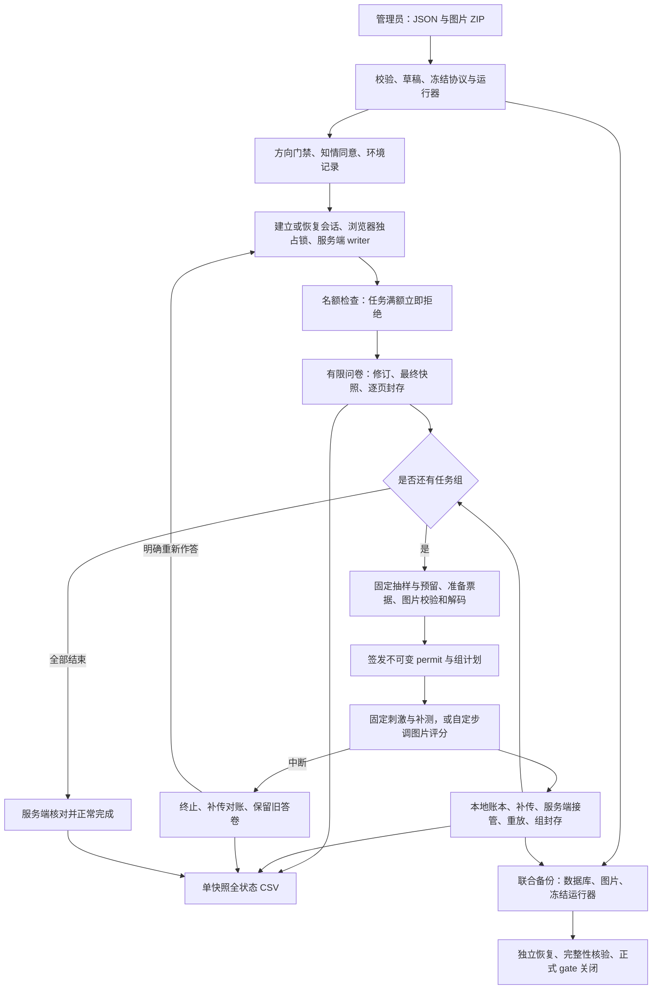

# 当前项目逻辑与设计优化

> 并发、准入和容量口径已于 2026-10-11 同步。完整预算、默认 2／1 与特定 ECS 7／7 的区别见 [并发设计与容量验收](并发设计与容量验收.md)。

后续轻量化实施见 [浏览器轻量采集与传输设计](浏览器轻量采集与传输设计.md)：补充被动环境/输入/生命周期信息、减少重复编码与布局扫描，并引入有界原生 gzip；保留原文、校验链和当前业务闭环。本文以下记录全项目讨论时的基线，后续验收计数单独记录。

2026-10-11。基于当前工作区，使用 Gemini Bridge 分 54 段讨论 118 份第一方源码、页面样式、脚本、部署和构建配置，再进行整体设计收敛。输入快照、文件摘要、请求与完整回复保存在 [讨论记录](gemini全项目设计/README.md)。本文记录采用的项目设计；Gemini 原文中的过时行为、推测与不准确路径保留在原文，不作为运行合同。

项目继续采用 Node/Fastify 单应用、单 SQLite 写 worker、单个按需维护 worker。数据库维持 WAL/FULL；问卷、固定刺激和图片评分保留各自运行方式。此次优化集中于任务策略共用、数据库所有权、恢复边界和文档一致性。

## 1. 完整业务链路

| 业务范围 | 实际模块 | 权威状态和设计边界 |
| --- | --- | --- |
| 协议导入与条件校验 | `shared/questionnaire-json.ts`、`protocol.ts`；`server/lab-store.ts` | 人可读 JSON 编译为受限协议；拒绝未知字段、非法分支、重复身份、不可能的设计和超预算配置。草稿存于 `lab_studies`，发布后协议和资源引用存于不可变版本。 |
| 研究管理与认证 | `web/admin.ts`、`main.ts`；`server/auth.ts`、`lab-routes.ts` | 单管理员密码、不透明 Cookie、Origin/CSRF 和有限登录请求。开放/隐藏、软删除与正式采集 gate 分开；版本与历史记录继续保留。 |
| 方向、同意与环境 | `web/orientation-gate.ts`、`consent-gate.ts`、`environment.ts`、`participant-api.ts` | 先检查方向、再取得同意，然后采样环境和建会话。同意文档哈希和服务端接受时间独立保存在 `lab_consents`，无 consent seal；拒绝不建作答会话。 |
| 会话与单写者 | `web/participant.ts`、`run.ts`、`ledger.ts`；`server/lab-store.ts` | Web Locks 防同一浏览器多页同时作答；服务端凭据、writer/epoch 和 permit 提供独立限制。页内 writer 标识可以用 sessionStorage，但答案、原始事件、发件箱和提交意图使用 IndexedDB。 |
| 整例名额 | `server/session-admission.ts`；`web/session-gate.ts` | `groups` 非空会话计入全局任务名额；纯问卷不占这类名额。SQLite 持久保存活动票据、租约及许可占位，满额立即拒绝，不保留等待序位。 |
| 问卷修订、分支与封存 | `web/survey-page.ts`、`scale-input.ts`、`text-pager.ts`；`shared/protocol.ts` | 有限题型、逐题呈现、条件 AST、IME 处理和同屏预算。修订记录保留；最终页面快照经服务端验证和 seal 后才前进，跳题与未到达状态分别导出。 |
| 抽样、分配与准备 | `shared/trial-sampling.ts`、`trial-design.ts`、`prng.ts`；`server/lab-store.ts` | 评分组抽样在下载前固定并持久保存，预留续期不重抽；permit 固定种子、原始试次、顺序、请求时长、帧量化、几何和预算。分配身份只能建立一次。 |
| 图片字节和解码 | `server/image-package.ts`、`private-files.ts`、`preparation-queue.ts`；`web/asset-download.ts`、`prepare.ts` | 服务端验证 ZIP、路径、标头和预算；客户端串行下载原字节、核对摘要/尺寸并实际解码。服务端标头通过不证明完整可解码。准备满额也立即拒绝，活动票据续期不属于等待排队。 |
| 固定刺激与动态补测 | `web/run.ts`、`runner-input.ts`；`shared/scheduler.ts`、`run-replay.ts` | 固定刺激、反馈、ISI；首个合法输入决定答案。有界补测使用确定性 PRNG、持久开始意图和提交截止点；超时或时序失效终止，不能延长阶段等待存储或网络。 |
| 图片评分 | `web/rating-run.ts`；`shared/rating-replay.ts` | 图片等待显式评分提交；评分变化、首选和提交时间分别记录，清图后计 ISI。多轴和年龄按配置执行。它不复用固定刺激的被动响应窗口。 |
| 交互与原始账本 | `web/interaction-recorder.ts`、`ledger.ts`、`local-store.ts`；`shared/interaction.ts` | 指针/键盘/屏幕节点与主任务记录分开保存；原始事件与 outbox、链头及提交意图在本地事务中一致更新。未获确认的数据不能按上传尝试删除。 |
| 接管、链与冲突 | `web/participant-api.ts`；`server/collection-store.ts`、`lab-store.ts` | 服务端原始 BLOB 在 `lab_raw`，逻辑事件在 `lab_events`，接管处置历史在 `lab_dispositions`。事务提交后 ACK；同身份同摘要幂等，同 ID 异摘要保留冲突证据；乱序或旧 writer 可接管为待对账。 |
| 重放、seal 与完成 | `server/lab-store.ts`、`maintenance.ts`、`maintenance-worker.ts` | 页 seal 核对快照；组 seal 绑定维护 worker 的确定性重放证据及当前源摘要。全部应有的页/组、seal 身份、路径、许可和诊断状态满足条件，才可正常完成。 |
| 中断、恢复与重答 | `web/participant.ts`、`participant-api.ts`、`task-liveness.ts`；`server/lab-store.ts` | 中断关闭许可并保留证据；历史补传与对账不把终止会话变成正常完成。显式重答建立有关联的新答卷，原本地记录与服务端答卷保留，不在旧 permit 中重做任务。 |
| 全状态 CSV 和质量 | `server/maintenance-worker.ts`、`lab-store.ts`；`web/admin.ts`、`replay.ts` | 同一有界读视图涵盖所有会话状态、原始字节、处置、题目/轴状态、试次结果、环境、同意和重答关联。CSV 使用 `table,data_json`；人工标记追加，不覆盖原始数据。 |
| 文件、备份与恢复 | `server/private-files.ts`、`maintenance.ts`、`maintenance-worker.ts`、`restore.ts` | 资源屏障→完成 Online Backup→从副本获取资源清单→源库核验并登记 pin→释放屏障→复制校验图片和运行器→READY。独立目标额外核验；恢复保持正式 gate 关闭。没有自动加密或 DB/文件跨系统原子事务保证。 |
| 工具、构建与部署 | `scripts/*`、`vite.config.ts`、`deploy/*` | 本地图片优化与 CSV 转换、独立 TEST_ONLY 预览、故障/容量探针、预压缩发行、备份与运维各有入口。SurveyJS 仅在检查页按需加载。服务器运行已构建发行物及生产依赖，保持单应用实例。 |

上表模块路径均相对 `src/`，最后一行保留仓库路径。P0 的 `collection-*`、`web/p0.ts` 与固定测试合同继续作为独立可靠性诊断入口，不替代已发布研究的 lab 合同。

## 2. 状态和故障处理

本地持久保存、服务端接管、范围封存、整例完成是四个不同事实。界面显示结束语必须以服务端 `COMPLETED` 为依据。

| 当前事实或故障 | 可以执行 | 不应推断或执行 |
| --- | --- | --- |
| 仅本地保存，尚无 ACK | 保留原始 bytes、同身份补传 | 上传调用结束就删本地事件 |
| ACK 为 `PERSISTED` | 记录 custody；读取 `ACCEPTED`/`RECEIVED_PENDING`/`QUARANTINED` 处置 | 把接管凭证视为答案有效或会话完成 |
| Manifest 尚缺事件、存在额外事件或诊断 | 补传、读取报告、保持提交意图 | 跳页、缩小 Manifest 掩盖冲突 |
| 一页或一组已 `SEALED` | 前进至下一合法位置；同请求重取相同 seal | 重写该范围的原始作答或重新执行旧试次 |
| 组已结束但封存回应丢失 | 从本地 pending 重试保存/核对，释放图片内存 | 再呈现本组并重新取答案 |
| 未关闭 permit，执行过程不明 | 关闭为终止/未知并补传；旧版本保留其恢复交互 | 租约过期就当许可已经安全结束 |
| 新策略任务刷新或切后台 | 中断与核对；新版本未知运行自动关闭 | 在旧 permit 上继续猜测此前呈现次数 |
| `TERMINATED` | 历史接管、对账；显式新建关联答卷 | 回写为正常完成、假称删除了旧答卷 |
| 整例/准备名额已满 | 409 和建议 30 分钟后重试，已有保存数据保留 | 显示等待序位、自动放行或循环重试 409 |
| 活动准备票据取消 | 精确 nonce 释放；实际传输退出后回收占用 | 用迟到释放请求撤销新票据或提前重复使用传输名额 |
| DB RPC 已发送但结果不明 | 返回 `UNKNOWN`，保存请求身份，待原 worker 退出后对账 | 当作 `NOT_INGESTED` 换身份提交 |
| DB RPC 从未发送 | 返回 `NOT_INGESTED`，按有限预算重试 | 报告已入库或正常 ACK |
| 旧数据库 owner 仍存活且心跳过期 | 拒绝新 owner；由运维确认旧进程退出后恢复 | 仅以 30 秒心跳停顿允许第二应用进入 |
| 导出/备份中断 | 作业状态与实际文件对账，恢复未决屏障/pin | 将部分产物标为 READY、按时间直接释放 pin |

诊断使用独立作用域，不混入问卷/组主链。允许诊断补传也不意味着诊断问题对正常完成没有影响：当前 finalize 会检查诊断，仍需按质量证据处理。

## 3. 当前容量和活动策略

两级准入、HTTP／gzip／DB 预算、单写者、维护作业和代表负载验收统一见 [并发设计与容量验收](并发设计与容量验收.md)。任务 `limited_active` 与纯问卷 `unlimited_active` 分开统计；任务／准备 `queued` 固定为 0，DB 内部队列继续有界调度。

源码和部署示例默认 `SESSION_CONCURRENCY=2`、`PREPARATION_CONCURRENCY=1`，配置允许 1–10000 的整数。这是合法配置范围，不是已验收容量范围。两者分别管理任务会话与图片准备，不能通过启动多个应用实例扩容。

任务会话满额返回 `SESSION_CAPACITY_FULL`；图片准备满额返回 `PREPARATION_CAPACITY_FULL`。两者均 HTTP 409，带 `Retry-After: 1800`，不创建 FIFO 等待条目。`lab_session_queue` 和 `PreparationQueue` 的旧命名、`QUEUED` 类型及历史列保留兼容；历史等待条目退为 LEFT，原始答案保留。纯问卷只绕过任务名额限制，仍受 HTTP/DB 有界接收、认证、存储及设备约束。

已保存的 [ECS 记录](ecs-capacity-and-idle.md)采用 7/7 作为特定图片评分工作负载的运行上限。这份结果不自动适用于不同图片字节/像素、固定时序、组长、手机或后台维护负载；更改研究条件后应按代表负载重新确认。

共享策略定义在 [`src/shared/task-policy.ts`](../src/shared/task-policy.ts)。`idle120-offline300-v1` 固定为：

| 参数 | 当前合同 |
| --- | --- |
| 用户空闲 | 120 秒无可信指针、键盘或输入操作，客户端中断 |
| activity 续活 | 最多每 60 秒一次小型非阻塞控制请求，单次超时 10 秒 |
| 客户端失联 | 300 秒未收到成功 activity 确认，中断 |
| 服务端失联 | 300 秒未接收续活，30 秒扫描周期，关闭可能在 300–330 秒发生 |
| 终止回调 | 监测自身先停止计时器和监听，只报告一次；停止后的晚到响应不再影响任务 |
| 版本识别 | 声明已知策略才启用；未知声明拒绝，旧 runner 无字段继续原合同 |

新固定刺激和图片评分运行器都会发 activity。刺激循环不等待图片下载、组事件上传或封存，activity 在后台进行；不能称为“组内零 HTTP”或物理硬实时。旧归档运行器文件与摘要继续按原合同保留。未来修改这些时限应定义新策略身份，并明确旧策略支持，不能直接更改 v1 数值。

## 4. 本轮采用的改进

| 改进 | 实施与作用 |
| --- | --- |
| 共享任务策略 | 浏览器监测、permit readiness、HTTP 强制策略、服务端视图/扫描及构建声明共同引用同一常量，减少数值与版本身份漂移。 |
| 活动监督收尾 | 超时即自清理；显式停止、HTTP 晚到和 JSON 解码晚到均不重复触发中断。 |
| 拒绝未知 runner 策略 | 可选字段缺失保持旧版本；未知字符串、null 或错误类型不能静默按无策略放行。 |
| 数据库 owner 接管 | 旧 PID 存活或无法确认退出时拒绝；只有 `ESRCH` 才允许另一 owner。心跳作为诊断，不作为退出凭据。 |
| 重答界面 | 按钮改为“重新作答”，明确新建关联答卷，避免“删除此前答卷”与实际保留行为冲突。 |
| 工具和运行器夹具 | 两个负载脚本升级为 v3，记录容量拒绝且不轮询等待；混合探针单独保证中断/对账路径。运行器测试统一 UTF-8、使用真实可解码 PNG，并操作现行评分滑块。 |
| 故障测试启动预算 | 启动使用正常默认预算，启动后的 RPC 故障仍为 150ms；保留 UNKNOWN/NOT_INGESTED、失 ACK 后原身份恢复断言。 |
| 现行设计入口 | README 指向本文；历史 FIFO 文件标为被覆盖，旧测量继续保留原日期与场景。 |

PID 检查是当前单机部署的保守所有权保护。PID 被复用或旧进程假死可能导致拒绝启动；应由服务管理确认旧实例已退出再重启，不为可用性解除写者约束。本轮未增加需要 `sd_notify` 配合的 systemd watchdog。

## 5. 后续演进的触发条件

| 候选工作 | 启动证据 | 保留的合同 |
| --- | --- | --- |
| 逐域拆分 `LabStore` | 新功能反复跨研究/参加者/资源/运维改动，事务边界难以评审 | 共享同一写连接和外层事务；权限、幂等身份和提交后 ACK 保持；一次迁移一个操作集合。 |
| 重放与清理预算优化 | 代表负载中明确出现事务超预算、重放长尾或扫描阻塞 | 不删原始事件，不减少确定性校验；限制批量并保留当前源摘要绑定。 |
| 前端存储/交互采样优化 | 真实设备测量证实 IDB/序列化/记录采样影响帧或截止点 | 原始事实、原子提交、已执行试次不可重做及确定性重放保持；先调整现有批处理。 |
| 大规模导出与恢复 | 实际作业超过已配置行数/字节/时间或恢复预算 | 现有 CSV 已使用游标逐行写入，不再重复“引入流式导出”；扩展前必须保持单读视图、所有状态、清单和资源 pin。 |
| 并发或存储架构变更 | 目标主机混合采集与维护测量证明当前单 writer/磁盘持续达不到研究预算 | 先调代表负载与有界预算；Redis、ORM、集群、PG 和自动 GC 均需独立需求及故障回归依据。 |

不采用无测量依据的数组/Map/GC 重写、任意内存或失败比例阈值、自动票据宽限和备份“无损”表述。真实设备、物理时序及独立恢复仍按实际证据验收，设计讨论不能替代这些结果。

## 6. 验证记录

修改前：类型检查、生产构建、SQLite smoke 通过；105 项单元测试中 104 通过，一项故障夹具在全套并行下超过原 1000ms 启动预算。

修改后针对性验证：20/20 通过，包含存活 owner 的过期/缺失心跳拒绝接管、真正进程崩溃后的重启、活动监督单次中断、停止后的 HTTP/JSON 晚到、未知策略拒绝、旧策略兼容和名额回收。完整回归通过类型/构建/SQLite smoke、109 项单元、37 项 Chromium 浏览器和 5 项独立运行器测试。两个 v3 负载探针完成，名额及准备流最终均清空；混合探针确认中断后可对账。详细结果见 [validation.json](gemini全项目设计/validation.json)，数字属于该轮基线。后续轻量化轮记录为 116 项单元／故障、39 项 Chromium 和 5 项运行器，见 [轻量化-validation.json](gemini全项目设计/轻量化-validation.json)。本次文档同步未重跑完整套件、部署或修改正式研究数据。
