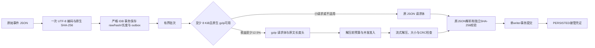

# 浏览器轻量采集与传输设计

2026-10-11，根据“轻量化、尽可能采集浏览器可提供的信息、低开销压缩与校验”的要求继续实施。保持单 HTTP 应用、单 SQLite writer、现有维护 worker；未增加运行依赖、服务、采样 worker 或轮询接口。Gemini 讨论与取舍见 [记录](gemini全项目设计/README.md)。

## 采集范围和频率

以浏览器原生返回值为事实，采集当前研究页面、输入与运行环境。静态属性在知情同意后采一次；动态状态按浏览器派发事件保存；固定刺激的关键时序继续由运行器记录。信息来源、缺失和能力限制也属于数据，不能用设备推断补齐。

| 范围 | 已采内容 | 频率与成本边界 |
| --- | --- | --- |
| 浏览器与设备 | UA/低高熵 Client Hints、平台/版本、语言、时区/偏移、locale/calendar/numberingSystem、逻辑处理器、设备内存、触摸点 | 首次环境快照；UA 解析标为 heuristic，浏览器可隐藏或缩减信息。 |
| 屏幕与窗口 | screen/available/color/pixel depth、方向、窗口外尺寸/位置、viewport/DPR、visualViewport/缩放、滚动、媒体偏好/输入能力/HDR/色域 | 静态快照和对应变化事件；CSS 像素及媒体查询不能证明物理设备类型、实际色准或显示延迟。 |
| 图形与 API | 既有 WebGL vendor/renderer/version/texture 上限，IDB/Web Locks/WebCrypto/Canvas，CompressionStream/DecompressionStream、合并事件、scheduler/input-pending、PerformanceObserver 支持类型 | 原有一次 WebGL 查询后释放 context；支持标志不保证 API 后续调用成功。 |
| 网络与页面状态 | 在线状态、连接类型/估计 RTT/下行/节流，安全上下文、跨源隔离、Cookie/DNT/GPC、可见性、焦点、全屏/PiP 状态 | 初始快照；online/offline/connectionchange、focus/blur/visibility、fullscreen、方向、visualViewport、pagehide/pageshow/freeze/resume 时记录。只读网络估计，没有测速流量。 |
| 加载与时钟 | navigation 的 DNS/连接/TLS/请求/响应/DOM/load 数值阶段、传输与编码/解码体积、paint；timeOrigin/performance/Date/document timeline | 采样当时可见的数值；未完成阶段可以是 0。时间值不能证明跨设备对齐或一次测出时钟漂移。没有资源完整 URL/查询参数，referrer 仅保留原有 origin。 |
| 存储、电池与权限状态 | quota/usage、已持久化状态、电量/充电；位置、相机、麦克风、通知、运动传感器、剪贴板和持久存储的只读权限状态 | 异步探针并行，每项 250ms 等待上限；`available`、`unsupported`、`blocked-or-error`、`timeout` 分开保存。`permissions.query` 不请求授权，也不读取位置、媒体、传感器或剪贴板内容。 |
| 输入与轨迹 | 所有派发及合并的 pointer 样本：时间/坐标/按钮/压力/接触宽高/tilt/twist/切向压力/主指针；click/dblclick/contextmenu、指针捕获、wheel 增量、修饰键 | 事件驱动，样本不去重、不降采样、不人为舍入 Float32 压力；每次派发只取一次 target/context/rect。不同时开启 pointerrawupdate，避免叠加重复来源。 |
| 键盘与编辑 | key/code/repeat/location/modifiers/composition，beforeinput/input 的 inputType/data，composition 全阶段，控件值，copy/cut/paste 的操作类型 | 仅当前参加者页面；不访问剪贴板对象。textarea/select 也保留值和 disabled 状态。 |
| 可见布局 | 元素和文字矩形、基础样式、控件值、Canvas 图片 ID/文本、视口/DPR/滚动 | 页面步进和刺激变化显式同步快照；普通输入引起的重复请求按同一 microtask 合并；滚动快照按帧合并并标 `capture=animation-frame`。状态与原始输入仍逐事件保存。 |

没有启用持续电池/存储/权限轮询、设备枚举、字体枚举、Audio/Canvas 指纹、传感器或媒体流。原始事件只反映浏览器派发给页面的内容；被浏览器屏蔽、未派发或浏览器外的信息无法补采。

## 记录成本与有界持久化

仍使用 `environment-v1` / `interaction-v1`，新增信息为附加字段。旧冻结运行器可以继续发送旧结构；旧答卷不补生成未采事实。交互继续写入独立 `d-ui-*` 诊断链，主答案封存、调度与重放算法保持原合同。

每批最多 64 样本、约 90 KiB，100ms 刷写；单事件原文上限 128 KiB，本机账本队列最多 64 个操作。可见节点最多 1900，达到保护边界时保存 `nodes_truncated=true`；大型单快照若超过事件预算会按现有恢复路径提示，不能静默认定为完整。当前有限逐题页面远小于节点边界。压缩不扩大这些预算。

共享 `TextEncoder`，原文在追加时只做一次 UTF-8 编码，该字节同时用于大小检查和原生 WebCrypto SHA-256。IDB 行新增可选 `byte_length`，环境元信息新增可选摘要；outbox 批处理和环境凭证校验优先复用。对象仓库/索引/数据库版本保持不变；没有缓存字段的旧行会重新计算。上传结构仍只包含 `event_id/hash/raw`，服务端独立验证原文摘要，缓存不是服务端的信任依据。

停止记录会补拍待处理快照、清理监听器和计时器并刷写；drain 等待此前未完成的保存。关闭页面时仍只能尽力刷本机数据：系统终止前未提交的尾部诊断不能保证保留，不能据此生成完成凭证。恢复继续使用原 outbox、manifest 和对账流程。

## 压缩和校验合同

压缩仅用于参加者 `ingest` / `covariates` POST，使用浏览器原生 `CompressionStream('gzip')`。UTF-8 原文至少 8 KiB且 gzip 体积不超过原文的 87.5% 才发送压缩体；不支持、失败或收益不足使用同一明文 JSON。浏览器 API 不提供可选 gzip 级别，这里避免增加压缩库。准备一次后，503/429 退避重试复用同一请求体和身份。模糊超时仍交给账本恢复，不擅自变更事件或完成状态。

HTTP 使用 `Content-Type: application/json`、`Content-Encoding: gzip` 和 `X-Uncompressed-Length`。服务端先验证路由和长度，再按 `decoded*2 + wire预算 + 128KiB流预算 + 1024` 预占原有接收配额，兼顾解析/克隆占用；未知 wire 长度预占完整 1 MiB。声明长度仅用于准入和实际核对，不能代替实际计数。

编码体及解码体均最多 1 MiB，解码还不得超过声明值；结束时必须精确相等。最多 4 个 gzip 请求占用解压名额，15 秒接收超时。Node 原生异步 zlib 流解压，保留 Fastify 的 bodyLimit 和 encoded-length 检查。损坏、截断、CRC 错误和超限均在 handler/数据库提交前拒绝；错误时停止读入，先返回错误再关闭未完成上传，避免无界排空。结束、错误、客户端断开和应用关闭会清理流/计时器/名额。

gzip 内置 CRC32 用于传输损坏检测；SHA-256 继续绑定不可变事件、链、manifest、资源身份与接管凭证。没有另外实现 CRC/xxHash，没有用非密码学校验替换身份校验。数据库中的原文、图片原字节和资源摘要保持不变，服务器 ACK 仍在事务提交后产生。

小控制请求、登录、封存和已压缩图片/ZIP 保持当前编码；静态 JS/CSS 继续在构建时预生成 gzip/Brotli，避免请求时压缩。当前没有引入数据库原文压缩或实时 API 响应压缩。

## 测量与验证

`npm run profile:transport` 可复测原生压缩、异步解压/JSON 解析和 UTF-8/SHA-256 开销。合成 16 事件交互批次的 JSON 请求体为 202,312 B，gzip 为 5,594 B，减少 97.23%。Chromium 测试派发的 100 个合并触笔样本连同页面记录也参与测量；具体字节、10 次测量的中位时间和运行环境见 [transport-profile.json](gemini全项目设计/transport-profile.json)。数据是隔离 TEST_ONLY 夹具，时间在本机 Node 原生 API 下测得，不作为移动端、ECS 或其他研究的容量保证；收益随重复字段、文本和批次大小变化。

| 测试样本 | 原 JSON / gzip 请求体 | 减少 | 准备中位耗时 | 解压及解析中位耗时 | UTF-8及SHA-256中位耗时 |
| --- | --- | --- | --- | --- | --- |
| 61 B 控制请求 | 61 B / 明文 61 B | 0% | 0.001ms | <0.001ms | 不含事件 |
| 合成 16 事件交互批次 | 202,312 B / 5,594 B | 97.23% | 0.826ms | 0.469ms | 0.147ms |
| Chromium 采集的 6 条测试记录 | 172,454 B / 9,562 B | 94.46% | 2.681ms | 0.891ms | 0.696ms |

2026-10-11 本机 Node 24.21.0，10 次测量中位数，不含 HTTP/TLS、SQLite或IDB开销。准备包含 UTF-8编码、Blob/流构建和原生 gzip；CRC32包含在原生解压中。SHA测量包含逐条 UTF-8编码、原生摘要及核对；生产新追加事件复用同一编码字节。原生压缩级别由 API 决定，额外 CPU 和字节收益均按实际样本评估。

浏览器测试验证全部 100 个合并样本保留、每派发仅一次 coalesced 调用/target rect 读取、原生压力数值精确保留、附加输入/生命周期字段、真实 gzip 上传、原文/hash/长度、旧缓存缺失后的离线恢复、权限错误和超时不阻断作答。传输故障测试覆盖 CRC/截断/膨胀/虚报长度、重试同字节、并发保护、断开与超时回收。运行器模拟接口已支持 gzip，继续检查主任务语义。完整结果见 [轻量化验证记录](gemini全项目设计/轻量化-validation.json)。

默认 `npm run check` 已通过类型检查、生产构建、SQLite smoke、116 项单元/故障、39 项浏览器和 5 项运行器测试。本次没有提交或部署，也没有修改实际研究数据。
